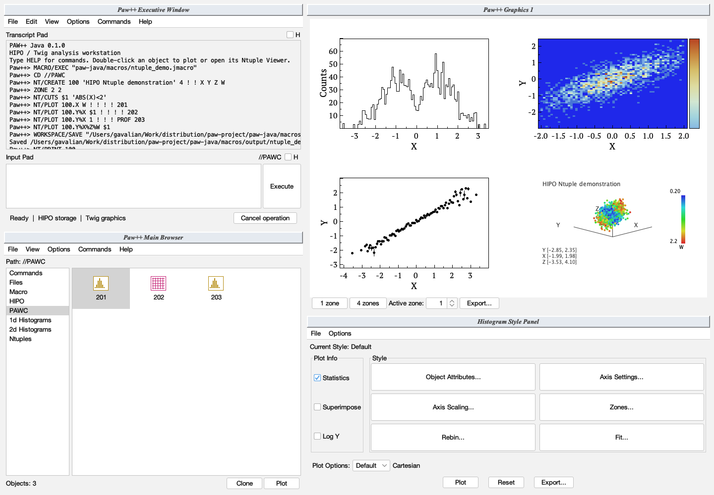

# PAW Ntuples with HIPO storage

Ntuple commands follow the original PAW command definitions in the [CERNLIB PAW source](https://github.com/apc-llc/cernlib/blob/master/2005/src/pawlib/paw/cdf/pawcdf.cdf), the supplied `../../paw.pdf` Ntuple chapter, and `../tut.pdf` Ntuple examples. Numeric IDs, command parameter order, `!` defaults, `$n` cuts, one-based row ranges, `%` projections and logical-unit directories are retained. `NT/` and unambiguous command abbreviations such as `NT/PROJ` are accepted. Optional parameters may be named, for example `NT/SCAN 10 OPTION=S VARLIS=X:Z`. `NT/HELP` and `MASK/HELP` open the searchable reference; missing required arguments open the existing parameter form with supplied values preserved.

HIPO replaces HBOOK/RZ. Fortran/COMIS callbacks are Java `.jmacro` method bodies, as requested. The implementation covers the reference's twenty Ntuple commands and four mask commands:

| Commands | Behavior |
| --- | --- |
| `CREATE`, `LIST`, `PRINT`, `DUPLICATE` | Create, inspect and duplicate schemas. DUPLICATE creates an empty definition, not a row copy. |
| `READ`, `DUMP` | Append ASCII input and export expressions. Free input and numeric Fortran fixed formats support repetition, nested groups, I/F/E/D/G fields, implied decimal positions, X/T/TL/TR positioning and P scaling. MATCH supports a fixed column, column 1 by default, or any column with `(*)`. Numeric values following the required columns are ignored. Invalid input does not append partial rows. |
| `PLOT`, `PROJECT` | Weighted selections and numeric expressions; PLOT resets unless `+`, PROJECT accumulates in a booked histogram without drawing. `id.Y%X` is Y versus X. Three expressions render 3D points; a fourth maps to colour. `G` renders gridded minimum, mean and maximum surfaces. Automatic binning uses a first pass to obtain limits. |
| `SCAN` | Text scans with expression/column ranges. `S` spider, `S2` radial segments, `A` mean overlay; graphical scans ask whether to continue or run continuously. |
| `LOOP`, `UWFUNC` | Row callbacks, including weighted selections and mask writing. UWFUNC creates a Java skeleton and can print it, emit tags, or open the editor. |
| `GCUT`, `CUTS`, `CSELECT` | Mouse range/polygon cuts, nested expression cuts, cut files, contour drawing and selection labels. |
| `CHAIN`, `HMERGE` | Append file/unit/chain members, delete members/chains, display trees or rebase paths. Merge compatible banks by ID and add compatible histograms. Cycles, missing members and incompatible schemas are rejected. |
| `RECOVER` | Physically scan native records and rebuild the HIPO index. Complete readable records are retained; original data survives if recovery cannot produce a valid file. |
| `LINTRA` | Principal components of up to twenty expressions, optionally standardized, sorted by eigenvalue. Generates `xtoxsi.jmacro`; use `id.xtoxsi.jmacro(1)` to plot its first component. |
| `VMEM` | Bounded HIPO row cache, default 10 MB; 0 disables it, -1 reports memory, -2 lists cached banks. Rows beyond the budget remain streamed. |
| `FLAGS_QP` | Java query diagnostics: TRACE, TIMING and STRICT, each 0 or 1. These replace the obsolete CERN query-processor internals. |
| `MASK/FILE`, `CLOSE`, `LIST`, `RESET` | Native HIPO, row-indexed 32-bit masks; R/N/U access modes, saved bit descriptions, read-only enforcement and dataset identity checks. |

`HI/FILE unit 'file.hipo' ! N` declares a new logical-unit destination. Opening an existing file omits `N`. `CD //LUN7` selects its Ntuples; `CD //PAWC` returns to memory, while numeric `CD 2` still selects a canvas region. `HROUT` writes current-directory Ntuples to the current unit; `HRIN` imports into memory with an optional numeric ID offset; `CLOSE 7` closes the unit. `H/DELETE` also deletes Ntuples; `*` clears objects in the selected directories. HBOOK buffer hints (`NPRIME`, `NEWBUF`, record length) remain accepted positional parameters; HIPO handles allocation and record layout, while `VMEM` controls the query cache.



## Example

```text
NT/CREATE 10 'Measurement' 3 ! ! X Y Z
NT/READ 10 'measurements.txt'
NT/CUTS $1 'ABS(X)<2.AND.Y>0'
NT/PLOT 10.X $1
NT/PLOT 10.Y%X $1
NT/SCAN 10 $1 20 1 ! X:Z
NT/DUMP 10.Y%X $1 ! ! 'selected.csv' ! ,
WORKSPACE/SAVE 'analysis.hipo'
```

Run `MACRO/EXEC 'macros/ntuple_demo.jmacro'` for a reproducible four-region demonstration. It creates numeric ID 100 and writes `macros/output/ntuple_demo.hipo`. Created/imported Ntuples appear under **Main Browser → Ntuples**; double-click an ID to use the Viewer and Scanner. Viewer row ranges also start at 1. Workspace snapshots preserve native banks, numeric types, IDs, titles, dataset identities and histograms together.

## Generate random data

```text
NT/RANDOM 'a/I,b/F,c' 10000 'random.hipo'
NT/RANDOM 'a/I,b/F,c/F' 10000 'repeatable.hipo' 42 12345
```

Syntax: `NTUPLE/RANDOM columns rows filename [id] [seed]`. `NTUPLES/RANDOM` is also accepted. Column declarations are comma-separated: `/I` means a native HIPO integer, `/F` means a native HIPO float, and an omitted type means float. Type letters are case-insensitive. Integers are uniformly distributed from 0 through 99; floats are uniformly distributed in [0,1). The row count must be positive. The default PAW ID is 1; an optional seed reproduces the same numeric rows. The transcript reports the seed used.

The generated Ntuple appears in **Main Browser → Ntuples** and can be plotted immediately, for example `NT/PLOT 1.b`. Generation writes HIPO blocks directly instead of keeping all rows in memory. An existing Ntuple ID or output file is rejected; choose a different ID or filename. Invalid declarations and cancelled operations leave no partial output or registered Ntuple. Entering `NT/RANDOM` with missing arguments opens the parameter dialog with the supplied fields preserved.

## Java row callbacks

`NT/UWFUNC 10 'select.jmacro' E` generates an editable skeleton. A selection callback can contain:

```java
double x = paw.value("X");
paw.weight(Math.abs(x) < 2 ? 1.0 : 0.0);
```

Use `NT/LOOP 10 'select.jmacro'` or `NT/PLOT 10.X 'select.jmacro'`. The compiler runs once per query, with filename/line diagnostics; runtime failures also identify the row. `paw.eventNumber` is one-based, `paw.row()` is the column map, and `paw.globals` persists callback state. `paw.fillNtuple("20", x, y)` fills another previously created Ntuple. `paw.result(a,b,...)` supplies projection components, selected with `id.function.jmacro(1)`. Non-integer expression arguments, such as `function.jmacro(X,Y)`, are available through `paw.argumentValue(0)` and `(1)`. Callbacks can appear within selection/projection expressions. Paths without spaces may be embedded; a standalone callback path can contain spaces. Use callbacks without side effects in automatic-binning plots, which evaluate selections twice; LOOP executes once per row.

Expressions accept case-insensitive column/function names, `**`, `=`, `.AND.`, `.OR.`, `.NOT.`, `.EQ.`, `.NE.`, `.LT.`, `.LE.`, `.GT.`, `.GE.`, chained bounds, numerical weights and common mathematical functions. A missing selection or `0` means no cut. Save bit 4 with `X>0>>chosen(4)` and reuse it with `chosen(4).AND.Y>0`. Open `chosen.hipo` with `MASK/FILE` first.

Fresh plots use the canvas's next-region method; `S` keeps the current plot region. `NUPD` refreshes the developing histogram in its original region. Earlier displayed histograms retain their contents after a later projection replaces the same ID. `PROF`, `PROFS` and `PROFI` retain weighted mean, spread and effective-count error conventions; `+` can accumulate profile passes within the session.

## Storage adaptations and bounds

HIPO banks contain numeric scalar columns. Defaults match PAW row-wise real values (`F`); `name:B/S/I/L/F/D` preserves native numeric bank types. Integer expressions must be exact in double precision (absolute values at most 2^53−1); larger 64-bit inputs are rejected instead of rounded. HIPO bank rows, rather than events containing possibly many rows, define the row indices. CHAIN ranges work across concatenated bank rows, an extension of PAW's unspecified chain range behavior.

The scalar expression language does not import Fortran array/common-block definitions or character columns. G surfaces use a 16×16 grid and omit cells without four populated neighbours. The display caps 3D points at one million and GCUT uses at most the first 100,000 selected points; histogram projections and output scans remain streamed. Browser table scans retain the first 1,000 accepted rows. Java source generation uses CREATE_NEW to preserve an existing edited callback; choose another filename or remove the old generated file before regenerating. Saved profile bin contents/errors survive snapshots; the accumulation sums used for subsequent `PROF+` are session state.

## Validation

Automated checks exercise real HIPO round-trips, numeric types and IDs, directory paths, weighted/reset/accumulating projections, profile errors, filters/ranges, nested cuts, ASCII/fixed-format input, persistent bit 32, read-only masks, Java compilation/loops, PCA, chains, merge, missing-index recovery, bounded caching, browser registration, parameter forms, mouse cut coordinates, overlays and canvas progression. The complete workstation suite also checks existing histogram, vector, macro and graphics behavior.
